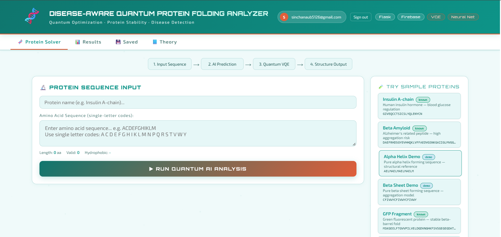
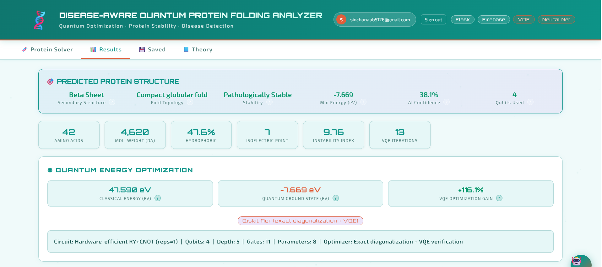
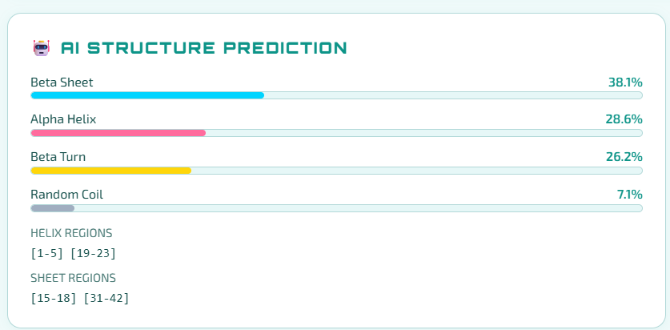
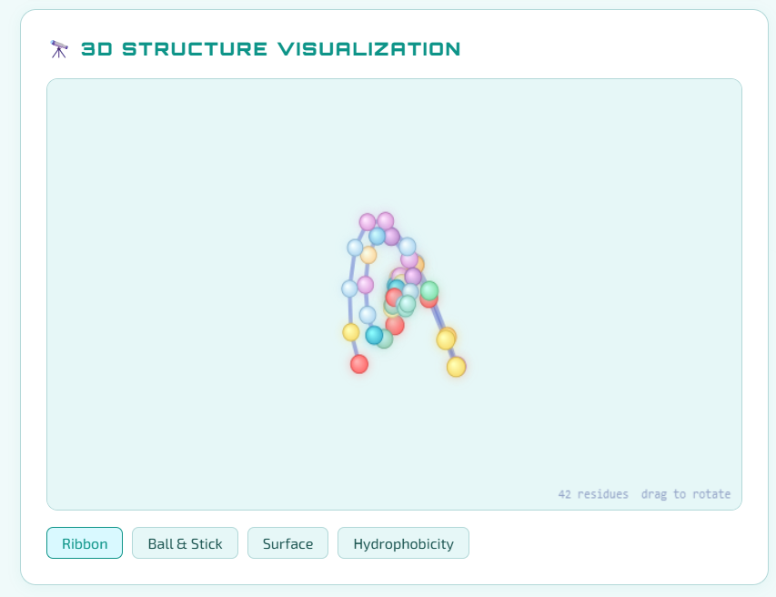
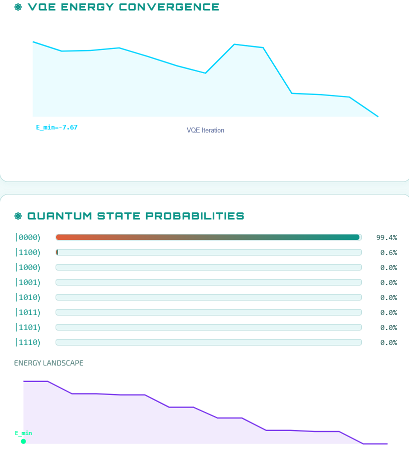
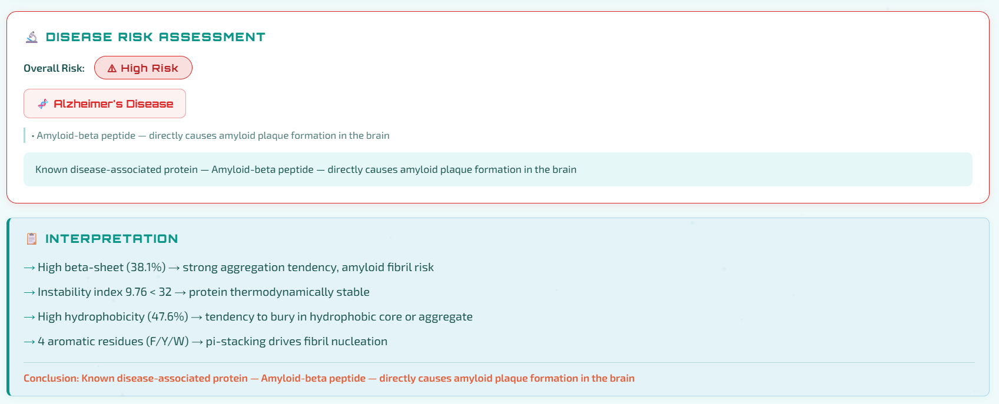
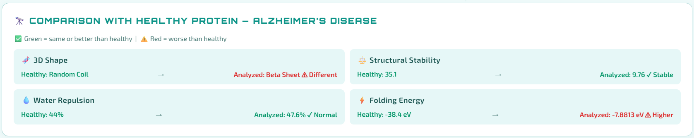
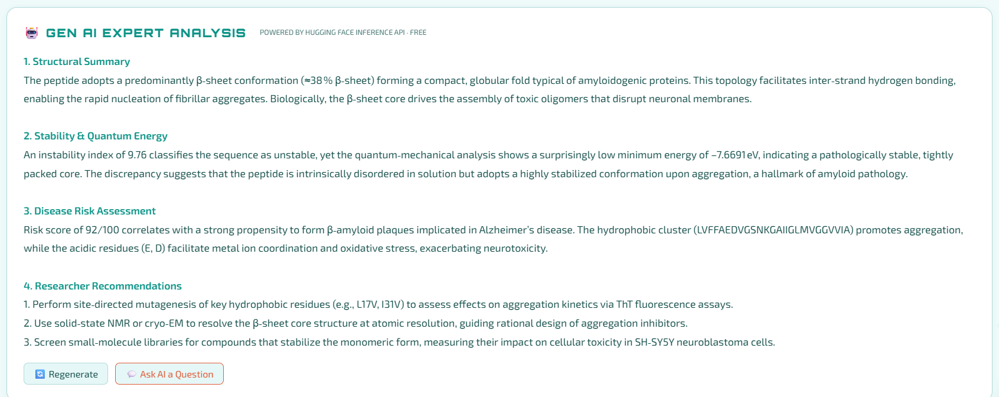
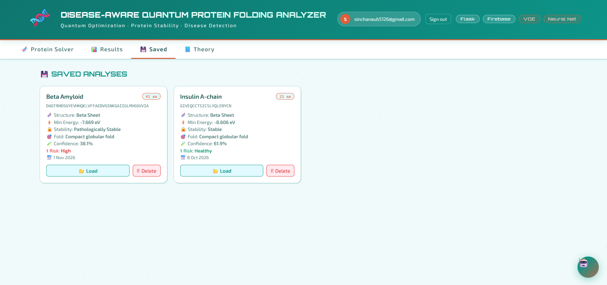

# The AI Dispatch

A community-driven daily AI news site. Approved writers publish articles, readers like them, and admins manage who can post. It's a single-page app built with plain HTML/JavaScript and Firebase, with no build step or backend server.

🔗 **Live site:** [add URL, e.g. your GitHub Pages link](https://quantum-protein-analyzer.onrender.com)

## Screenshots

| Sequence input | AI structure prediction |
|---|---|
|  |  |  |
| **3D structure visualisation** | **VQE convergence** |
|  |  |
| **Disease risk screening** | **Comparison with healthy reference** |
|  |  |
| **AI-generated explanation** | **Saved results** |
|  |  |

## Features

- **News feed** with a featured story, side stories, a card grid and a scrolling headline ticker, filterable by category (Models & Research, Business & Market, Gov & Policy, Health & Science, Society & Jobs, Tech & Tools)
- **Article reader:** open the full article in a modal
- **Likes:** one like per user, and guests are supported too
- **Authentication:** register and sign in with email and password
- **Role-based access:**
  - New accounts start as `pending`
  - `viewer`: can read and like articles
  - `poster`: can write articles and edit or delete their own
  - `admin`: can edit or delete any article
- **Admin panel:** approve or reject pending users (as viewer or poster), change roles, create or remove users
- **Article editor:** title, body, tag, optional image URL and author byline
- **Curated resource directory:** links to trusted AI sources (OpenAI, and others)
- Real-time updates: posts appear instantly using Firestore listeners

## Tech stack

HTML · CSS · JavaScript (ES modules) · Firebase Authentication · Cloud Firestore

Firestore collections: `posts` (articles, likes, authors) and `users` (display name, email, role).

## Run locally

The whole app is a single `index.html`, so you can open it directly in a browser, or serve it locally:

```bash
python -m http.server 8000
```

Then visit http://localhost:8000.

## Set up your own Firebase backend

If you fork this, point it at your own Firebase project:

1. Create a project at console.firebase.google.com.
2. Enable **Authentication → Email/Password** and create a **Cloud Firestore** database.
3. Replace the `firebaseConfig` object in `index.html` with your project's web config.
4. Register once, then set your user document's `role` to `admin` in Firestore to bootstrap the first admin.
5. Deploy `index.html` to GitHub Pages, Firebase Hosting or any static host.

## Security notes

Firebase web API keys are meant to be public, but your data is only as safe as your **Firestore security rules**. Role checks in the UI (`admin` / `poster`) are client-side, so mirror them in your Firestore rules before using this with real users.

## Future work

- Firestore security rules enforcing roles server-side
- Sanitize article content before rendering
- Comments and full-text search
- Pull in headlines automatically from AI news RSS feeds
